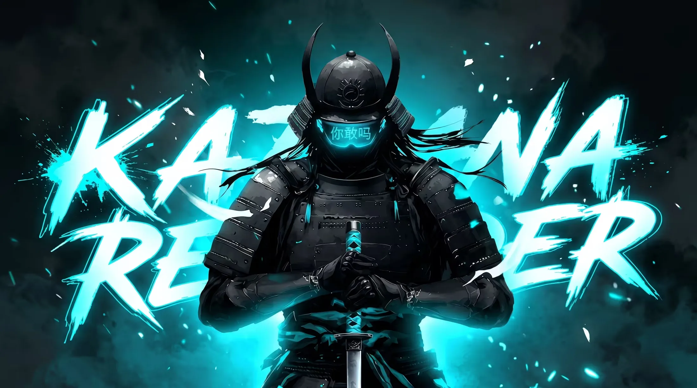
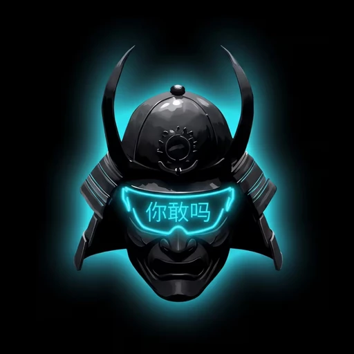
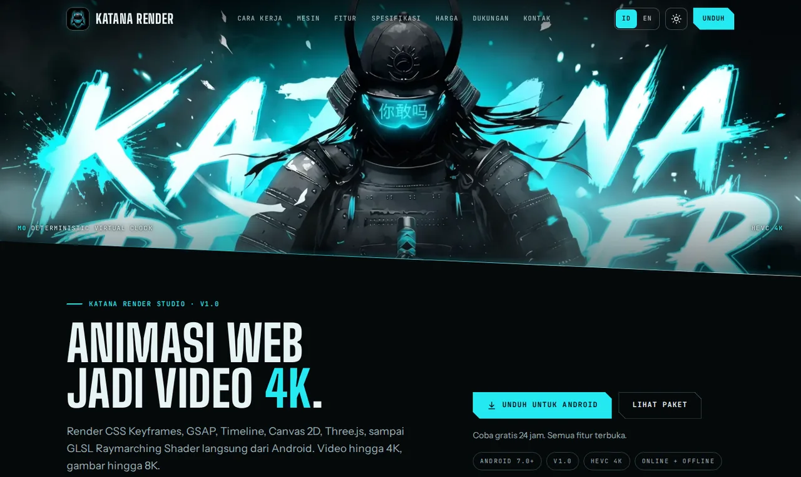
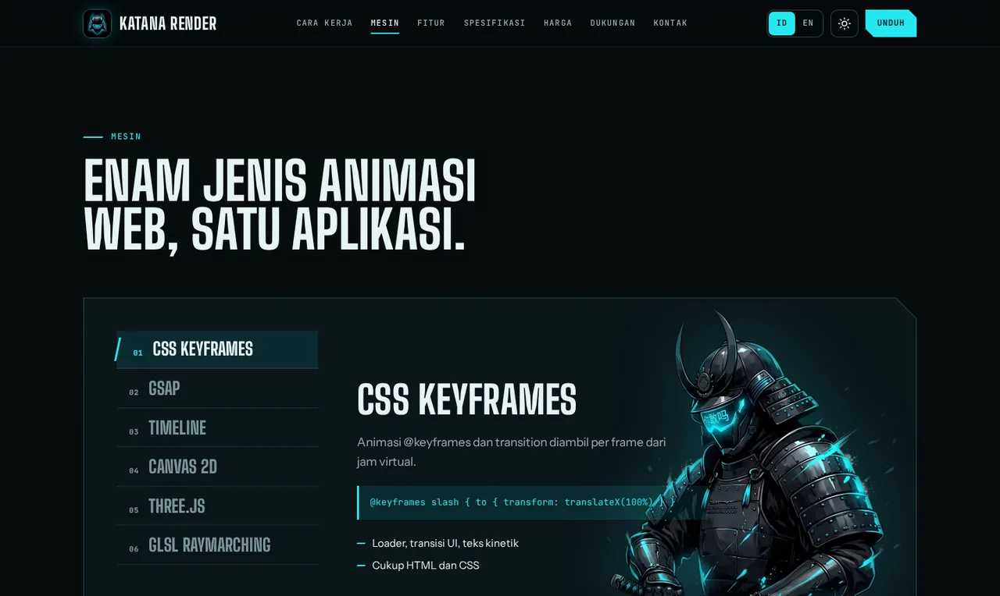
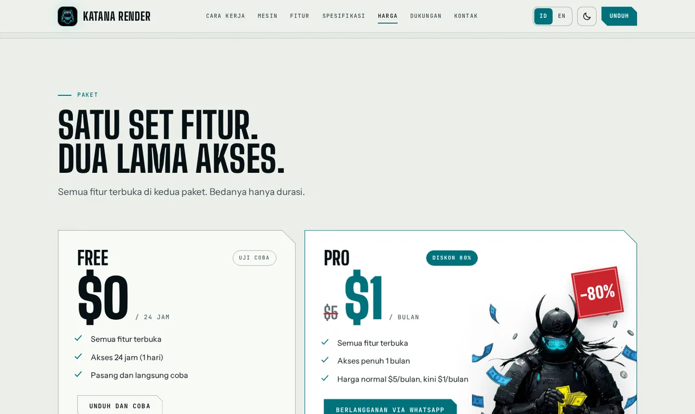
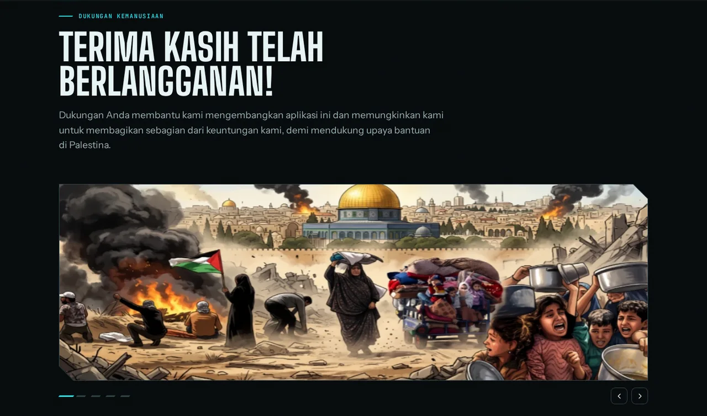
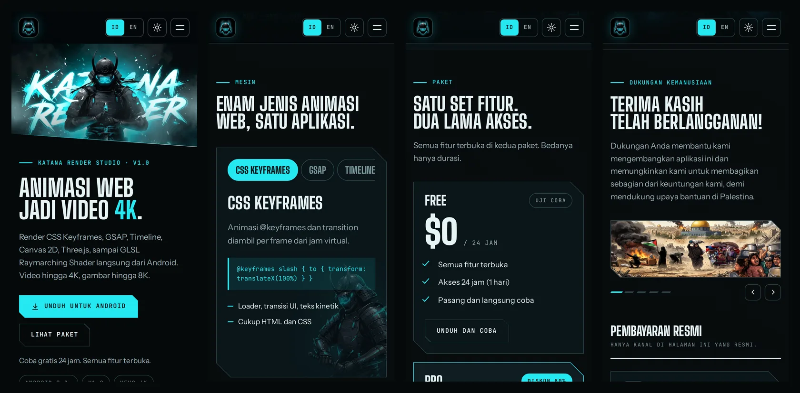

  

# KATANA RENDER

**Animasi web jadi video 4K · gambar hingga 8K**

Render CSS Keyframes, GSAP, Canvas 2D, Three.js, sampai GLSL Shader langsung dari Android. Online maupun offline.

 

 

Coba gratis 24 jam · semua fitur terbuka

 

[**Cuplikan**](#-cuplikan-tampilan) · [**Mesin**](#-enam-mesin-animasi) · [**Cara kerja**](#-cara-kerja) · [**Spesifikasi**](#-spesifikasi) · [**Paket**](#-paket-dan-harga) · [**FAQ**](#-pertanyaan-umum) · [**Kontak**](#-kontak)

 

---

## 🥷 Tentang

**Katana Render Studio** adalah aplikasi Android yang mengubah animasi web menjadi video hingga **4K** dan gambar hingga **8K**. Tulis atau tempel kode animasi Anda, aplikasi merendernya frame demi frame, lalu Anda simpan hasilnya sebagai video atau gambar.

- **Tanpa koneksi pun jalan.** Dipakai online maupun offline.
- **Frame selalu tepat waktu.** Mesin M0 mengatur waktu animasi sendiri, jadi hasil tidak bergantung pada seberapa cepat ponsel Anda bekerja.
- **Empat pintu masuk kode.** Edit manual, impor file HTML, arsip ZIP, atau muat dari live web.
- **Video dan gambar.** MP4, WEBP, GIF, APNG, PNG, JPG, serta vektor SVG, EPS, dan AI.

 

## 📸 Cuplikan tampilan

**Hero** · banner bergeser tipis mengikuti kursor, kabut neon bergerak pelan

  

<table>
<tr>
<td width="50%"></td>
<td width="50%"></td>
</tr>
<tr>
<td align="center"><b>Mesin</b> · enam tab, bisa dinavigasi dengan keyboard</td>
<td align="center"><b>Paket</b> · tema terang, kontras warna dijaga lolos AA</td>
</tr>
</table>

 

**Dukungan Kemanusiaan** · galeri banner yang bergeser tanpa putus, ditambah pembayaran resmi dengan tombol salin dan kode QRIS

  

**Mobile first** · menu layar penuh, tab yang bisa digulir, galeri yang bisa di-swipe

 

## ⚙️ Enam mesin animasi

| # | Mesin | Cocok untuk |
|:-:|---|---|
| 01 | **CSS Keyframes** | Loader, transisi UI, teks kinetik. Cukup HTML dan CSS |
| 02 | **GSAP** | Motion graphic berlapis, urutan dan easing presisi |
| 03 | **Timeline** | Intro, outro, lower third, banyak adegan dalam satu proyek |
| 04 | **Canvas 2D** | Partikel, generative art, grafik data bergerak |
| 05 | **Three.js** | Logo 3D dan produk, sampai video 4K |
| 06 | **GLSL Raymarching Shader** | Visual abstrak dan fraktal, latar loop yang bersih |

 

## 🎬 Cara kerja

| | Langkah | Yang terjadi |
|:-:|---|---|
| **01** | **Masukkan kode** | Tulis atau tempel kode sendiri, impor file HTML, buka arsip ZIP, atau muat dari live web |
| **02** | **Render per frame** | Mesin M0 menghitung tiap frame dari jam virtual, bukan jam perangkat. Video sampai 4K |
| **03** | **Ekspor hasil** | Simpan sebagai video atau gambar, raster maupun vektor |

 

## 📋 Spesifikasi

| | |
|---|---|
| **Nama rilis** | Katana Render Studio |
| **Pengembang** | Cloud Sunnah |
| **Versi** | v1.0 |
| **Kompatibilitas** | Android 7.0 (API 24) atau lebih baru |
| **Arsitektur mesin** | M0 Deterministic Virtual Clock |
| **Enkoder** | HEVC (hingga 4K) |
| **Keluaran video** | `MP4` · `WEBP` · `GIF` · `APNG` |
| **Keluaran gambar** | Raster: `PNG` · `JPG` — Vektor: `SVG` · `EPS` · `AI` |
| **Pintu masuk kode** | Edit manual · impor file HTML · arsip ZIP · live web |

 

## 💳 Paket dan harga

Semua fitur terbuka di kedua paket. Bedanya hanya lama akses.

| | **Free** | **Pro** |
|---|:-:|:-:|
| Fitur | Semua terbuka | Semua terbuka |
| Akses | 24 jam | 1 bulan |
| Harga | **$0** | **$1** / bulan (normal $5, diskon 80%) |
| Cara mulai | Unduh dan langsung coba | Berlangganan via [WhatsApp](https://wa.me/6285648545159?text=Halo%20Cloud%20Sunnah%2C%20saya%20ingin%20berlangganan%20Katana%20Render%20Pro.) |

 

## ❓ Pertanyaan umum

<b>Apa bedanya Free dan Pro?</b>

 
Fiturnya sama, semuanya terbuka. Bedanya hanya durasi: Free 24 jam, Pro 1 bulan.

<b>Bisa dipakai tanpa internet?</b>

 
Bisa. Katana Render dapat dipakai online maupun offline.

<b>Format apa saja yang bisa diekspor?</b>

 
Video: MP4, WEBP, GIF, APNG. Gambar: PNG dan JPG (raster), SVG, EPS, dan AI (vektor).

<b>Berapa resolusi maksimalnya?</b>

 
Video hingga 4K dengan enkoder HEVC, gambar hingga 8K.

<b>Butuh Android versi berapa?</b>

 
Android 7.0 (API 24) atau lebih baru.

<b>Bagaimana cara berlangganan Pro?</b>

 
Hubungi Cloud Sunnah lewat WhatsApp atau email di bagian <a href="#-kontak">Kontak</a>.

 

## 🤝 Dukungan Kemanusiaan

Dukungan Anda membantu pengembangan aplikasi ini, dan sebagian keuntungan dibagikan untuk mendukung upaya bantuan di Palestina. Terima kasih telah berlangganan.

Pembayaran resmi, lengkap dengan kode QRIS, GoPay, dan Bank Jago, hanya ada di halaman Dukungan Kemanusiaan pada situs Katana Render. **Kanal di luar halaman tersebut tidak resmi.**

 

## ⬇️ Unduh

**Katana Render v1.0** untuk Android 7.0 ke atas

 

## 📬 Kontak

| | |
|:-:|:-:|
| 💬 **WhatsApp** | [0856 4854 5159](https://wa.me/6285648545159) |
| ✉️ **Email** | [cloudsunnah.message@gmail.com](mailto:cloudsunnah.message@gmail.com?subject=Katana%20Render) |

 

<b>🇬🇧 English summary</b>

 

**Katana Render Studio** is an Android app (7.0+) that renders web animation (CSS Keyframes, GSAP, Timeline, Canvas 2D, Three.js and GLSL raymarching shaders) into video up to 4K (HEVC) and images up to 8K, online or offline.

Bring your code by typing it, importing an HTML file, opening a ZIP archive, or loading from the live web. Export to MP4, WEBP, GIF, APNG, PNG, JPG, SVG, EPS or AI.

**Plans:** Free gives 24 hours of full access at $0. Pro gives 1 month of full access at $1/month (normally $5). To subscribe, message Cloud Sunnah on WhatsApp or email.

 

---

**Katana Render Studio** · v1.0 · dikembangkan oleh **Cloud Sunnah** © 2026 · Seluruh hak cipta dilindungi.

