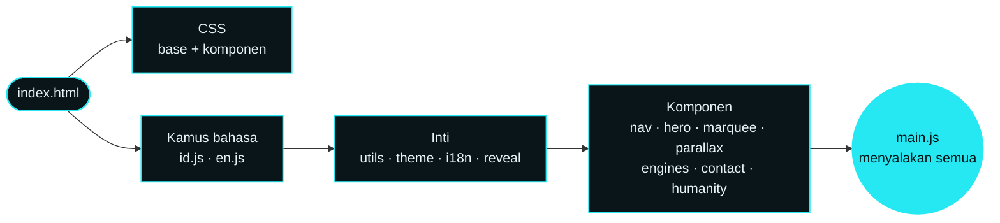

<div align="center">


<br><br>


# KATANA RENDER

$\color{#00b4c0}{\textbf{Animasi web jadi video 4K}}\ \ \color{#8a9ba0}{\textsf{·}}\ \ \color{#00b4c0}{\textbf{gambar hingga 8K}}$

*Website promosi resmi **Katana Render Studio** — aplikasi Android untuk merender animasi web ke video dan gambar beresolusi tinggi.*

<br>


<br>

[**Tentang**](#-tentang) · [**Cuplikan**](#-cuplikan-tampilan) · [**Aplikasi**](#-tentang-aplikasinya) · [**Fitur situs**](#-fitur-situs) · [**Arsitektur**](#-arsitektur) · [**Struktur**](#-struktur-proyek) · [**Menjalankan**](#-menjalankan) · [**Mengubah isi**](#-mengubah-isi) · [**Desain**](#-sistem-desain) · [**Kontak**](#-kontak)

</div>

<br>

---

## 🥷 Tentang

Repositori ini berisi **situs statis** untuk mempromosikan Katana Render. Dibangun dengan HTML, CSS, dan JavaScript murni: **tanpa framework, tanpa proses build, tanpa CDN**. Font dibundel lokal sehingga halaman tetap utuh saat offline.

$$
\color{#00b4c0}{\boxed{\textsf{Satu folder}}} \;\longrightarrow\; \color{#00b4c0}{\boxed{\textsf{unggah ke hosting statis}}} \;\longrightarrow\; \color{#00b4c0}{\boxed{\textsf{selesai}}}
$$

| | |
|---|---|
| 🎯 **Tujuan** | Memperkenalkan aplikasi, menampilkan paket Free dan Pro, mengarahkan pengunjung ke unduhan dan kontak |
| 🌐 **Bahasa** | Indonesia dan Inggris, bisa diganti langsung dari navigasi |
| 🌗 **Tema** | Gelap dan terang, mengikuti sistem pengguna atau pilihan manual |
| 📱 **Perangkat** | Responsif dari ponsel kecil sampai layar lebar |
| 🪶 **Bobot** | Sekitar 2,4 MB seluruh proyek, termasuk gambar dan font |

<br>

## 📸 Cuplikan tampilan

<div align="center">


<sub>**Hero** · banner bergeser tipis mengikuti kursor, kabut neon bergerak pelan</sub>

<br><br>

<table>
<tr>
<td width="50%"></td>
<td width="50%"></td>
</tr>
<tr>
<td align="center"><sub><b>Mesin</b> · enam tab, bisa dinavigasi dengan keyboard</sub></td>
<td align="center"><sub><b>Paket</b> · tema terang, kontras warna dijaga lolos AA</sub></td>
</tr>
</table>

<br>


<sub>**Dukungan Kemanusiaan** · galeri banner yang bergeser tanpa putus, ditambah pembayaran resmi dengan tombol salin dan kode QRIS</sub>

<br><br>


<sub>**Mobile first** · menu layar penuh, tab yang bisa digulir, galeri yang bisa di-swipe</sub>

</div>

<br>

## 🎬 Tentang aplikasinya

**Katana Render Studio** mengubah animasi web menjadi video hingga 4K dan gambar hingga 8K, langsung dari Android, online maupun offline.

### Enam mesin animasi

| # | Mesin | Cocok untuk |
|:-:|---|---|
| 01 | **CSS Keyframes** | Loader, transisi UI, teks kinetik. Cukup HTML dan CSS |
| 02 | **GSAP** | Motion graphic berlapis, urutan dan easing presisi |
| 03 | **Timeline** | Intro, outro, lower third, banyak adegan dalam satu proyek |
| 04 | **Canvas 2D** | Partikel, generative art, grafik data bergerak |
| 05 | **Three.js** | Logo 3D dan produk, sampai video 4K |
| 06 | **GLSL Raymarching Shader** | Visual abstrak dan fraktal, latar loop yang bersih |

### Cara kerja

```text
 01  MASUKKAN KODE        →   02  RENDER PER FRAME       →   03  EKSPOR HASIL
     tulis / tempel            mesin M0 menghitung tiap         simpan sebagai video
     impor HTML, ZIP,          frame dari jam virtual,          atau gambar,
     atau muat dari            bukan jam perangkat              raster maupun vektor
     live web
```

### Jam virtual M0

Arsitektur **Deterministic Virtual Clock**: waktu animasi ditentukan mesin, bukan kecepatan perangkat. Dengan begitu setiap frame jatuh tepat di waktunya, secepat atau selambat apa pun ponsel merendernya. Gambaran prinsipnya:

$$
\color{#00b4c0}{t_n} \;=\; \frac{n}{\mathrm{fps}}, \qquad n = 0,\,1,\,2,\,\dots,\,N-1
\qquad\text{dengan}\qquad
N = \mathrm{fps} \times T
$$

> [!NOTE]
> Rumus di atas hanya **ilustrasi konsep** agar mudah dipahami, bukan dokumentasi internal mesin.

### Spesifikasi

| Item | Detail |
|---|---|
| **Nama rilis** | Katana Render Studio |
| **Pengembang** | Cloud Sunnah |
| **Versi** | v1.0 |
| **Kompatibilitas** | Android 7.0 (API 24) atau lebih baru |
| **Arsitektur mesin** | M0 Deterministic Virtual Clock |
| **Enkoder** | HEVC (hingga 4K) |
| **Keluaran video** | `MP4` · `WEBP` · `GIF` · `APNG` |
| **Keluaran gambar** | Raster: `PNG` · `JPG` — Vektor: `SVG` · `EPS` · `AI` |
| **Pintu masuk kode** | Edit manual · impor file HTML · arsip ZIP · live web |

### Paket

| | **Free** | **Pro** |
|---|:-:|:-:|
| Fitur | Semua terbuka | Semua terbuka |
| Akses | 24 jam | 1 bulan |
| Harga | **$0** | **$1** / bulan <sub>(normal $5)</sub> |

$$
\text{Diskon Pro} \;=\; \frac{5-1}{5} \;=\; \color{#e5484d}{\textbf{80}\%}
$$

<div align="center">

[](https://drive.google.com/file/d/1p0Or61ZKCvpSlq1IS3G8PipPp3eMgtTs/view?usp=drivesdk)

</div>

<br>

## ✨ Fitur situs

<table>
<tr>
<td width="50%" valign="top">

#### 🎨 Tampilan
- Dua tema, **tanpa kedip** saat dimuat
- Tekstur butiran kertas halus
- Sudut terpotong ala bilah katana
- Marquee mesin dengan warna bergilir
- Kabut hero digambar sekali di canvas kecil
- Parallax ringan pada karakter

</td>
<td width="50%" valign="top">

#### 🧩 Interaksi
- Navigasi dengan **penanda bagian aktif**
- Menu layar penuh di ponsel
- Tab mesin: panah, <kbd>Home</kbd>, <kbd>End</kbd>
- FAQ akordeon native `<details>`
- Tombol **salin** nomor dan email
- Galeri banner **looping tanpa putus**
- Dialog QRIS: perbesar dan unduh

</td>
</tr>
<tr>
<td width="50%" valign="top">

#### 🌐 Dua bahasa
- Kamus terpisah `id.js` dan `en.js`
- Bahasa awal dari bahasa peramban
- Pilihan tersimpan di `localStorage`
- Judul halaman, meta, dan teks alt ikut berganti

</td>
<td width="50%" valign="top">

#### ♿ Aksesibilitas dan performa
- Tautan **Lompat ke konten**
- Fokus keyboard terlihat jelas
- Menghormati `prefers-reduced-motion` (gerak ambient tetap jalan)
- Animasi hanya `transform` dan `opacity`
- Gambar WebP, `loading="lazy"`, ukuran eksplisit
- Kabut hero dan autoplay galeri dijeda saat di luar layar

</td>
</tr>
</table>

<br>

## 🧭 Arsitektur



**Prinsip:**

- Satu namespace global `KR`; setiap komponen mengekspos satu fungsi `KR.initXxx()`.
- Urutan `<script>` di `index.html` penting: kamus → inti → komponen → `main.js`.
- Skrip `theme-init.js` dijalankan di `<head>` sebelum CSS agar tema langsung benar.
- Satu file CSS per komponen, semua warna dan ukuran dasar dari **token**.

<br>

## 📁 Struktur proyek

```text
katana-render-website/
├── index.html                    kerangka halaman (semua bagian)
├── README.md
│
├── css/
│   ├── base/                     fonts · tokens (warna) · reset · typography · layout
│   └── components/               satu file per komponen
│       ├── nav · hero · marquee · workflow · engines · features · specs
│       ├── pricing · humanity · download · faq · contact · footer
│       └── buttons · toast
│
├── js/
│   ├── main.js                   titik masuk
│   ├── core/                     theme-init · utils · theme · i18n · reveal
│   ├── i18n/                     id.js · en.js   (seluruh teks dua bahasa)
│   └── components/               nav · hero · marquee · parallax · engines
│                                 contact (salin) · humanity (galeri + dialog QRIS)
│
├── assets/
│   ├── img/                      karakter, banner, logo, ikon, og-image
│   │   ├── humanity/             banner Dukungan Kemanusiaan (1080×360)
│   │   └── pay/                  logo GoPay · QRIS · Bank Jago + kode QRIS
│   └── fonts/                    font lokal (woff2)
│
└── docs/screenshots/             gambar untuk README ini
```

<br>

## 🚀 Menjalankan

Tidak ada dependensi dan tidak ada langkah instalasi.

**Cara cepat:** buka `index.html` langsung di peramban.

**Cara disarankan** (agar perilaku sama seperti di hosting, misalnya tombol salin yang butuh *secure context*):

```bash
# dari dalam folder proyek
python3 -m http.server 8080
# lalu buka  http://localhost:8080
```

### Menayangkan di GitHub Pages

1. Unggah isi folder ini ke repositori, dengan `index.html` di akar repositori.
2. Buka **Settings → Pages**.
3. Pada *Build and deployment*, pilih **Deploy from a branch**, lalu pilih branch dan folder `/ (root)`.

> [!IMPORTANT]
> `og:image` di `index.html` memakai path relatif. Setelah situs punya domain, ganti dengan **URL absolut** agar pratinjau tautan tampil di WhatsApp dan media sosial.

<br>

## 🔧 Mengubah isi

| Yang ingin diubah | Lokasi |
|---|---|
| **Teks dan terjemahan** | `js/i18n/id.js` dan `js/i18n/en.js` — **kunci harus sama persis** di keduanya |
| **Warna** | `css/base/tokens.css` |
| **Link unduh** | cari `drive.google.com` di `index.html` (4 tombol, atribut `data-download`) |
| **Nomor WhatsApp** | `index.html` dan `js/core/i18n.js` |
| **Pembayaran resmi** | bagian `#humanity` di `index.html`: ubah teks tampilan **dan** atribut `data-copy` (nilai yang disalin, tanpa spasi) |
| **Kode QRIS** | ganti `assets/img/pay/me-bar-code.webp` (persegi, latar putih) |
| **Banner kemanusiaan** | ganti file di `assets/img/humanity/`; teks alt ada di kunci `hum.alt.*` |
| **Kecepatan galeri** | konstanta `DELAY` di `js/components/humanity.js` |

### Atribut data yang dipakai

| Atribut | Fungsi |
|---|---|
| `data-i18n="kunci"` | Isi teks elemen dari kamus bahasa |
| `data-i18n-html="kunci"` | Sama, tetapi boleh memuat HTML (misalnya `<em>`) |
| `data-i18n-attr="alt:kunci"` | Mengisi atribut (`alt`, `aria-label`, dan lain-lain) |
| `data-reveal` | Muncul halus saat di-scroll; `style="--d:120ms"` untuk jeda |
| `data-parallax="0.05"` | Elemen bergeser pelan saat di-scroll |
| `data-copy="nilai"` | Tombol yang menyalin `nilai` ke clipboard |
| `data-download` | Penanda tombol unduh |

> [!TIP]
> Setelah menambah teks baru, pastikan jumlah kunci di `id.js` dan `en.js` sama. Kunci yang hilang akan jatuh kembali ke teks Indonesia.

<br>

## 🎨 Sistem desain

Gelap berbasis tinta dan **cyan neon** yang diambil dari banner. Tema terang memakai kertas washi, dengan cyan digelapkan agar kontras lolos AA.

| Peran | Gelap | Terang |
|---|---|---|
| Latar | $\color{#05090b}{\blacksquare}$ `#05090b` | $\color{#eef1ec}{\blacksquare}$ `#eef1ec` |
| Permukaan | $\color{#0a1519}{\blacksquare}$ `#0a1519` | $\color{#f8faf6}{\blacksquare}$ `#f8faf6` |
| Teks | $\color{#e6f4f5}{\blacksquare}$ `#e6f4f5` | $\color{#071115}{\blacksquare}$ `#071115` |
| **Aksen** | $\color{#25e8f2}{\blacksquare}$ `#25e8f2` | $\color{#00717b}{\blacksquare}$ `#00717b` |
| Stempel | $\color{#ff4048}{\blacksquare}$ `#ff4048` | $\color{#c9232b}{\blacksquare}$ `#c9232b` |

| Fungsi | Font |
|---|---|
| Judul | **Big Shoulders Display** (700 · 800 · 900) |
| Isi | **Instrument Sans** (variabel) |
| Label dan kode | **JetBrains Mono** (variabel) |
| Motif visor | **Noto Serif SC** (subset 4 glif: 刀 你 敢 吗) |

Semua font dibundel lokal di `assets/fonts/` dalam format `woff2`.

<br>

## 📬 Kontak

<div align="center">

| | |
|:-:|:-:|
| 💬 **WhatsApp** | [0856 4854 5159](https://wa.me/6285648545159) |
| ✉️ **Email** | [cloudsunnah.message@gmail.com](mailto:cloudsunnah.message@gmail.com?subject=Katana%20Render) |

</div>

<br>

<details>
<summary><b>🇬🇧 English summary</b></summary>

<br>

**Katana Render** is the promotional website for *Katana Render Studio*, an Android app (7.0+) that renders web animation — CSS Keyframes, GSAP, Timeline, Canvas 2D, Three.js and GLSL raymarching shaders — into video up to 4K (HEVC) and images up to 8K, online or offline.

The site is **plain HTML, CSS and JavaScript**: no framework, no build step, no CDN, and fonts are self-hosted. It ships with a dark/light theme, a full Indonesian/English dictionary, keyboard-friendly tabs, a looping banner gallery, and a payment block with copy buttons and a QRIS dialog.

**Run it:** open `index.html`, or serve the folder with `python3 -m http.server 8080`.
**Edit it:** texts live in `js/i18n/id.js` and `en.js` (keys must match), colors in `css/base/tokens.css`, payment details in the `#humanity` section of `index.html`.

</details>

<br>

---

<div align="center">

$\color{#00b4c0}{\textbf{刀}}$

<sub>**Katana Render Studio** · v1.0 · dikembangkan oleh **Cloud Sunnah**<br>© 2026 · Seluruh hak cipta dilindungi.</sub>

</div>
